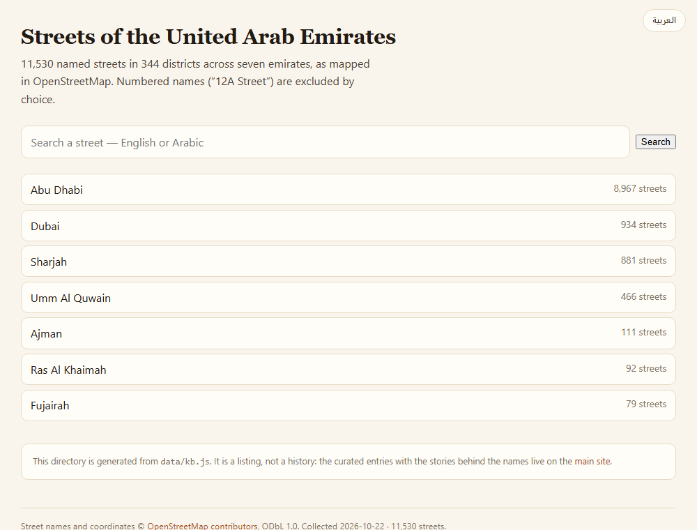

# UAE Streets

**A bilingual (Arabic/English) field guide to the names on UAE street signs — and a
directory of 11,470 named streets.**

[](https://github.com/juma-ali/uae-streets/actions/workflows/checks.yml)
**[The guide →](https://juma-ali.github.io/uae-streets/)** ·
**[The directory →](https://juma-ali.github.io/uae-streets/directory/)** ·
**[Search →](https://juma-ali.github.io/uae-streets/directory/search.html)**



Two halves of one dataset:

- **The guide** explains names. 34 researched entries — a ruler, a tribe, a harbour,
  a plain Arabic word — with the story behind each, in both languages.
- **The directory** lists them. Every named street collected from OpenStreetMap,
  grouped **emirate → district**, searchable, and bilingual throughout.

Both are static: no framework, no build step, no trackers.

**بالعربية:** دليل ميداني لأسماء شوارع الإمارات، وقائمة بكل الشوارع المسمّاة —
١١٬٥٣٠ شارعاً في ٣٤٤ حياً — بالعربية والإنجليزية، مع بحث يتعامل مع الكتابة العربية
كيفما كُتبت: [juma-ali.github.io/uae-streets](https://juma-ali.github.io/uae-streets/)

## What's inside

**The guide**

- **34 streets, all seven emirates** — from Sheikh Zayed Road to a single street in
  Umm Al Quwain.
- **Five naming patterns** — people, places, words, tribes, events.
- **Three sourcing states**, printed on every card: `documented` (on the record),
  `recorded account` (an account the project recorded, with no published source
  cited), `local` (told, not recorded). Folk etymology is never dressed up as fact.
- **Renames shown, not hidden** — a road the signs call one thing and people call
  another carries both, e.g. *Formerly Electra Street* / *Now officially Zayed The
  First Street*.
- **Route numbers** where a road has one — E 66, D 94.
- **Neutral, factual wording** for anyone named after a public figure: title and
  dates only, no evaluation, no controversy. Enforced by a lint, not by good
  intentions — see [docs/EDITORIAL.md](docs/EDITORIAL.md).

**The directory**

- **11,470 streets · 344 districts · seven emirates**, each with an Arabic name
  where OpenStreetMap has one (97% do).
- **Bilingual with a real toggle** — [English](docs/directory.png) and
  [Arabic](docs/directory-ar.png) are both first-class; Arabic flips the layout to
  RTL, uses Arabic-Indic numerals, and shows districts by their own Arabic names.
- **Search across both scripts** — diacritics stripped, `أ إ آ` unified, `ى`/`ي` and
  `ة`/`ه` treated as one, so `الوصل` and `al wasl` find the same road.
- **Story badges** — a street with a written entry links straight to it.
- **Honest gaps** — where plot numbers dominate, the page says so with the number:
  Dubai is 61% numbered, Ajman 62%, Abu Dhabi 8%.

## The data

Three files, one story:

| File | What it is | Licence |
|---|---|---|
| [`data/streets.js`](data/streets.js) | The 34 editorial entries | CC BY 4.0 |
| [`data/kb.js`](data/kb.js) | 11,470 streets, 344 districts, 7 emirates | **ODbL** |
| [`directory/`](directory/) | 358 generated pages + search index | **ODbL** |

An editorial entry, plain JavaScript:

```js
{
  id: "electra-street",
  emirate: "abu-dhabi",
  category: "place",           // person | place | word | tribe | event
  origin: "documented",        // documented | account | local
  ar: "شارع الإلكترا",
  en: "Electra Street",
  translit: "Shāriʿ al-Electra",
  now: { en: "Zayed The First Street", ar: "شارع زايد الأول" },
  route: "D 92",
  meaning: { en: "Named for the Electra electronics shop", ar: "نسبة إلى متجر إلكترا للإلكترونيات" },
  story: { en: "…", ar: "…" },
  refs: [{ label: "…", url: "…" }]
}
```

The knowledge base resolves every street to a four-level path —
`Abu Dhabi Emirate » Abu Dhabi » Abu Dhabi » Khalifa City` — built offline from the
OpenStreetMap extract by `tools/pbf-import.mjs` → `tools/pbf-boundaries.mjs` →
`tools/kb-country.mjs`, then rendered by `tools/wiki-build.mjs`. It is **never loaded
by the site**: the directory is pre-rendered, so a page weighs kilobytes.

Plot numbers (`12A Street`) are excluded by design; named stretches of one road
(`Al Aqhuwanah 1…9 Street`) collapse into a single row.

## Run it locally

No build step, no server, no dependencies:

```bash
git clone https://github.com/juma-ali/uae-streets.git
cd uae-streets
```

Open `index.html` for the guide, and `directory/index.html` for the directory —
double-click works, because data is loaded as plain scripts rather than fetched.
Deploying is covered in [CONTRIBUTING.md](CONTRIBUTING.md#6-publish-it).

## Verification

Four gates run on every push, and they fail the build rather than warn:

- `tools/arabic-lint.mjs` — Arabic wording, punctuation, Latin leakage
- `tools/editorial-lint.mjs` — neutrality on cards about public figures
- `tools/audit.mjs --assert` — KB invariants: naming convention, the plot-number
  filter, unique OSM ids, coordinates, all seven emirates present, districts
  referenced by real streets
- `tools/validate-forms.mjs` — the issue templates still parse

Beyond CI, the data has been checked against independent sources:
[docs/WIKI-CHECK.md](docs/WIKI-CHECK.md) (83% of Dubai roads named by Wikipedia
found exactly, 6 under another transliteration, **8 genuinely absent from OSM**) and
[docs/AUDIT.md](docs/AUDIT.md) (internal checks with counts and examples).

## Contributing

Adding a street takes about five minutes: copy an entry in `data/streets.js`, change
the values, refresh. Fields, rules and publishing steps are in
[CONTRIBUTING.md](CONTRIBUTING.md) — [بالعربية](docs/CONTRIBUTING.ar.md).

Not touching the code? Two forms do the job:
**[report a correction](https://github.com/juma-ali/uae-streets/issues/new?template=correction.yml)**
or **[suggest a street](https://github.com/juma-ali/uae-streets/issues/new?template=street.yml)**.
Both **require a public source**; a report without one is closed without action.

## Credits

Type: [Fraunces](https://fonts.google.com/specimen/Fraunces),
[Inter](https://fonts.google.com/specimen/Inter) and
[IBM Plex Sans Arabic](https://fonts.google.com/specimen/IBM+Plex+Sans+Arabic).
Street names and coordinates © [OpenStreetMap contributors](https://www.openstreetmap.org/copyright),
**ODbL 1.0**.

## License

Code is MIT; the 34 editorial entries are CC BY 4.0; the knowledge base and the
generated directory are ODbL 1.0. See [LICENSE](LICENSE).

## Status

Live at **[juma-ali.github.io/uae-streets](https://juma-ali.github.io/uae-streets/)**,
served from this repository by GitHub Pages. The guide's 34 entries are reviewed;
the directory follows OpenStreetMap, including its gaps — 13 streets the guide or
Wikipedia knows about that OSM does not yet name are tracked in
[docs/ROADMAP.md](docs/ROADMAP.md).
