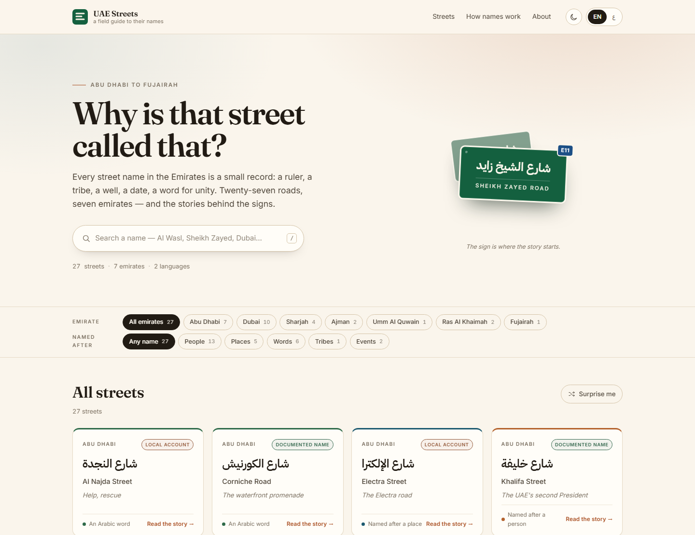

# UAE Streets

**A bilingual (Arabic/English) field guide to the names on UAE street signs** — the
people, tribes, words and events behind them.

[](https://github.com/juma-ali/uae-streets/actions/workflows/checks.yml)
**[Open the site →](https://juma-ali.github.io/uae-streets/)**



Every road name in the Emirates is a small record. Some honour a ruler or a family;
some point at a well, a harbour or a hill; some carry a plain Arabic word — *wasl*,
connection; *ittihad*, union; *wahda*, unity. This project collects 27 of them across
the seven emirates and explains, in both languages, where each name came from.

Each entry has the Arabic name as it appears on the sign, an English transliteration,
a one-line meaning, and a short story. Switch to Arabic and the whole layout flips to
RTL — not just the text.

**بالعربية:** دليل ميداني لأسماء شوارع الإمارات — من وراء كل اسم، ولماذا سُمّي به.
بالعربية والإنجليزية، وبحث يتعامل مع الكتابة العربية كيفما كُتبت:
[juma-ali.github.io/uae-streets](https://juma-ali.github.io/uae-streets/)

## What's inside

- **27 streets, all seven emirates** — from Sheikh Zayed Road to a single street in
  Umm Al Quwain.
- **Both languages throughout** — names, meanings, stories and interface, not a
  translation bolted on afterwards.
- **The naming grammar** — the five patterns behind almost every UAE street name:
  people, places, words, tribes, events.
- **Honest sourcing** — every entry is labelled `documented` (named for something on
  the record) or `local` (a widely told account with no official record), so folk
  etymology is never dressed up as fact.
- **Arabic-aware search** — diacritics stripped, `أ إ آ` unified, `ى`/`ي` and `ة`/`ه`
  treated as one, so a name can be found however it is typed.
- **Shareable views** — filters, query, language, theme and the open street all live
  in the URL.
- **Light and dark**, keyboard-friendly, no trackers.

## The data

All the content lives in one file, [`data/streets.js`](data/streets.js) — plain
JavaScript, no database, no CMS:

```js
{
  id: "al-wasl-road",
  emirate: "dubai",
  category: "word",          // person | place | word | tribe | event
  origin: "local",           // documented | local
  ar: "شارع الوصل",
  en: "Al Wasl Road",
  translit: "Shāriʿ al-Waṣl",
  meaning: { en: "Connection, joining", ar: "الوصل: ربط شيء بشيء" },
  story: { en: "…", ar: "…" }
}
```

A second file, [`data/index.js`](data/index.js), holds only basic information — the
OSM id, name tags, coordinates and the emirate → city → district grouping — for the
streets that could be matched. It is generated by `tools/osm-import.mjs` and, being
derived from OpenStreetMap, is **ODbL**: © OpenStreetMap contributors. The editorial
text stays CC BY.

## Run it locally

There is no build step, no dependencies and no server: `index.html` loads
`data/streets.js` as a plain script, so a browser is all it needs.

```bash
git clone https://github.com/juma-ali/uae-streets.git
cd uae-streets
```

Then open `index.html` — double-click it, or run `start index.html` on Windows or
`open index.html` on macOS. If you'd rather not clone, **Code → Download ZIP** and
unzip works exactly the same way.

Deploying it is a different question, and that's covered in
[CONTRIBUTING.md](CONTRIBUTING.md#6-publish-it).

## Contributing

Adding a street takes about five minutes: copy an entry in `data/streets.js`, change
the values, refresh. The field reference, the content rules and the publishing steps
are in [CONTRIBUTING.md](CONTRIBUTING.md) — [بالعربية](docs/CONTRIBUTING.ar.md).

Not planning to touch the code? Two forms do the job:

- **[Report a correction](https://github.com/juma-ali/uae-streets/issues/new?template=correction.yml)**
- **[Suggest a street](https://github.com/juma-ali/uae-streets/issues/new?template=street.yml)**

Both **require a public source**. A report without one is closed without action — a
guess corrected by another guess makes the guide worse. If a name's origin is better
documented than it is here, the fix belongs in the data, not in a comment.

Every push is checked: `tools/arabic-lint.mjs` for the Arabic wording and
`tools/validate-forms.mjs` for the issue forms.

Planned work — performance, Arabic review, content gaps — is tracked in
[docs/ROADMAP.md](docs/ROADMAP.md), each item with the trigger that starts it.

## Credits

Type: [Fraunces](https://fonts.google.com/specimen/Fraunces),
[Inter](https://fonts.google.com/specimen/Inter) and
[IBM Plex Sans Arabic](https://fonts.google.com/specimen/IBM+Plex+Sans+Arabic).
No framework, no build tooling, no analytics.

## License

Code is MIT; the street entries and stories are CC BY 4.0. See [LICENSE](LICENSE).

## Status

Live at **[juma-ali.github.io/uae-streets](https://juma-ali.github.io/uae-streets/)**,
served from this repository by GitHub Pages. The content is still being reviewed —
corrections are welcome, and the `local` labels mark what is told rather than
officially recorded.
